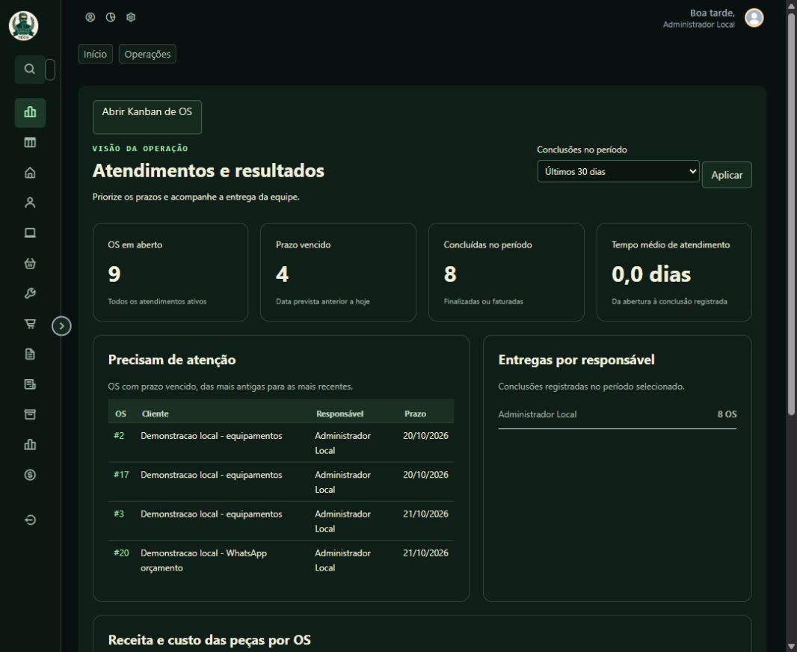
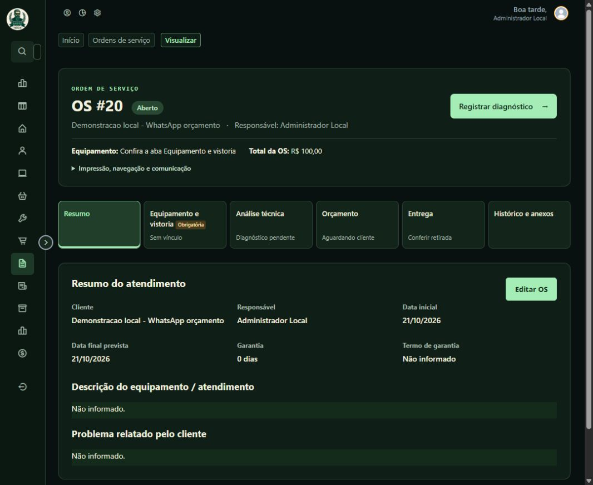
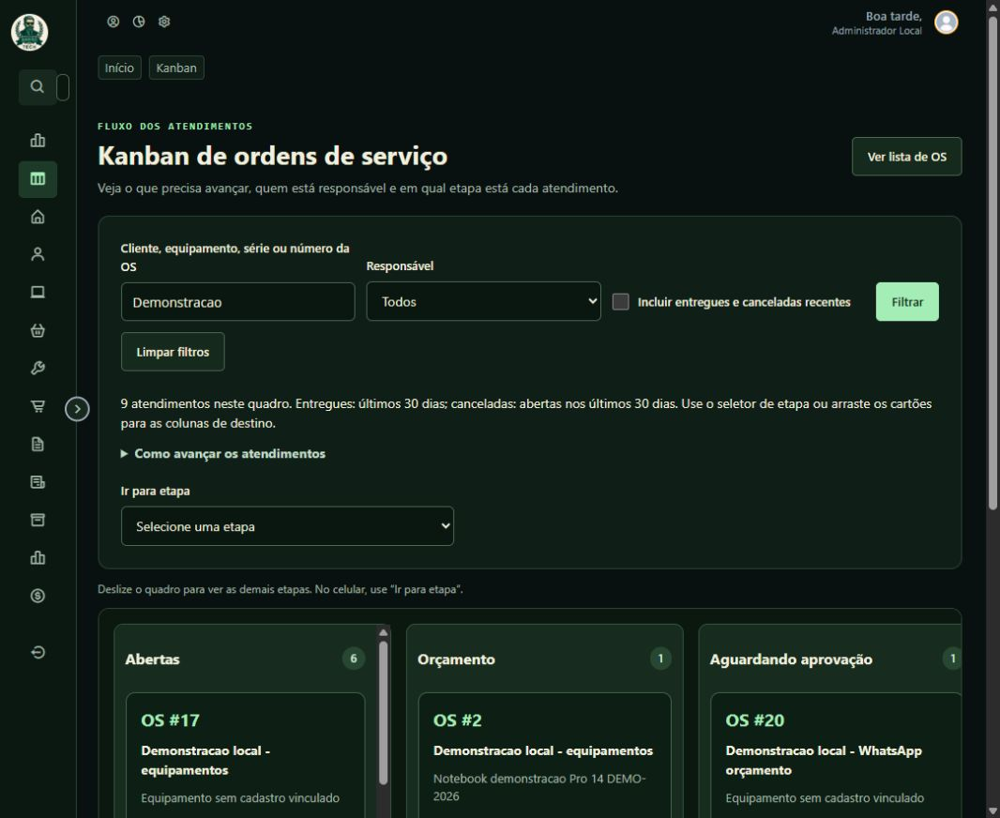
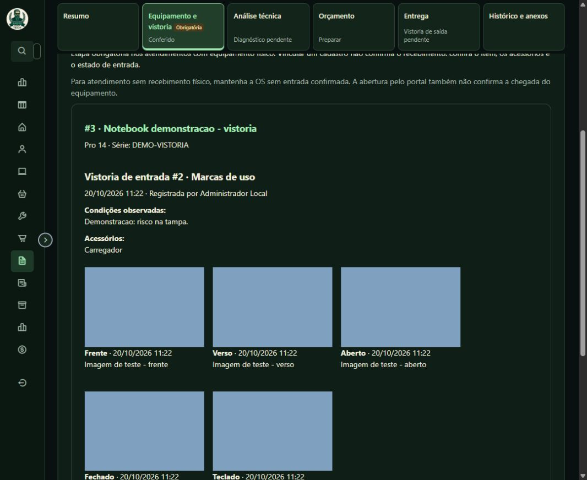
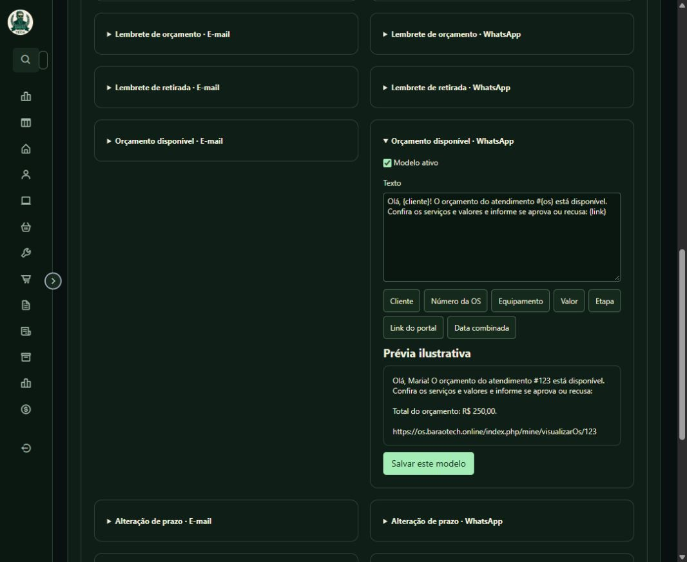

# Map-OS · Barão Tech

**Gestão de assistência técnica: da abertura da ordem de serviço à entrega documentada do equipamento.**

Fork do [Map-OS, de Ramon Silva e colaboradores](https://github.com/RamonSilva20/mapos), com identidade visual Barão Tech, fluxo de OS por etapas, vistorias, Kanban e comunicação com o cliente por WhatsApp/Baileys e e-mail.

[Melhorias do fork](docs/MELHORIAS.md) · [Galeria de telas](docs/GALERIA.md) · [Instalação e ambiente](docs/AMBIENTE.md) · [Histórico de alterações](CHANGELOG.md)

## O que este fork acrescenta

| Área | Melhorias implementadas |
|---|---|
| **Ordens de serviço** | Sete etapas: Resumo, Equipamento e vistoria, Análise técnica, Orçamento, Execução e testes, Entrega e Histórico e anexos. Aviso de alterações não salvas e formulários de ação independentes. |
| **Equipamentos e vistorias** | Vínculo com o cliente e a OS, recebimento físico explícito, estado e acessórios, fotos de Frente, Verso, Aberto, Fechado e Teclado, vistoria de saída e comprovantes. |
| **Checklists técnicos** | Modelos editáveis por notebook, desktop e outros equipamentos, com análise e execução em abas próprias, resultados, fotos privadas, referência de autorização e histórico por item. Revisão orientativa antes da entrega. |
| **Relatório técnico** | Preparação com textos para o cliente, escopo aprovado vigente, resultados selecionados, até seis fotos, prévia revisada e download em PDF. |
| **Orçamentos** | Produtos, serviços e descontos com cálculo no servidor; registro da versão apresentada e aprovação ou recusa pelo cliente. Alterações exigem nova conferência. |
| **Kanban** | Quadro por etapa, filtros e movimentação por arraste ou seletor. Aguardando aprovação e aguardando retirada refletem o andamento da OS. |
| **Comunicação** | WhatsApp/Baileys, configuração Gmail, preferências por cliente, fila com tentativas e histórico, lembretes limitados e envio de orçamento com prévia e confirmação. |
| **Notificações** | Modelos por evento e canal em Configurações → Notificações, variáveis, prévia ilustrativa, regras de envio e salvamento independente por seção. |
| **Identidade visual** | Tema Barão Tech selecionável, aplicado ao administrativo, logins e área do cliente; ajustes de layout em OS, cadastros, catálogos e Kanban. |
| **Operação e integridade** | Indicadores operacionais, custo das peças, transações compartilhadas entre navegador e API, controles contra duplicação de estoque e faturamento, backups verificados e testes automatizados. |

O registro de uma OS pelo portal **não confirma a chegada física do equipamento**. Finalização, faturamento e entrega são registros distintos. Este fork não inclui integração funcional com o UltraITSM nem gestão de SLA.

## Conheça as telas

Capturas reais da interface. As telas locais usam cadastros e valores de demonstração; a captura de Notificações usa apenas modelos e dados fictícios da prévia. Os números exibidos não representam resultados comerciais.

| Ordem de serviço por etapas | Kanban de atendimentos |
|---|---|
|  |  |

| Equipamento e vistoria | Modelos centralizados |
|---|---|
|  |  |

## Um sistema, dois acessos

| Caminho após o domínio | Acesso |
|---|---|
| `/index.php/login` | Administrador e equipe: operar o sistema, cadastrar e acompanhar atendimentos. |
| `/index.php/mine` | Cliente: consultar suas OS, responder ao orçamento e gerenciar preferências de comunicação. |

São áreas da **mesma instalação e do mesmo banco**, com autenticação e permissões próprias. Uma conta administrativa não é uma conta de cliente.

## Começar e manter

O ambiente do fork usa **PHP 8.4+, CodeIgniter 3, Composer 2, MySQL 8.4 e Nginx**, com composições Docker para desenvolvimento e produção. O serviço WhatsApp usa **Node.js, Baileys e SQLite** em rede interna. A base frontend mantém Bootstrap, jQuery e Matrix Admin, com os componentes e o tema do fork.

1. Siga o [guia de ambiente](docs/AMBIENTE.md) para configurar as variáveis privadas, as dependências e a instalação CLI.
2. Consulte os guias de [equipamentos e fluxo de OS](docs/EQUIPAMENTOS.md), [Kanban](docs/KANBAN.md) e [comunicação](docs/COMUNICACAO.md) e [checklists técnicos](docs/CHECKLISTS.md) e [relatório técnico](docs/RELATORIO-TECNICO.md).
3. Valide as mudanças localmente antes de publicar. Os testes de integração reinicializam somente o banco descartável `mapos_fork_test`; os testes HTTP que criam registros recusam URLs de produção.
4. Atualize pelo Git e pelo [fluxo de implantação com backup e verificação](docs/MELHORIAS.md#publicação-e-recuperação). O atualizador web do projeto original fica desativado neste fork para preservar as personalizações.

Não publique arquivos `.env`, credenciais, sessões WhatsApp, dumps ou anexos reais. Os canais começam desativados; o envio automático depende de configuração, modelo ativo e autorização registrada do cliente. As prévias não enviam mensagens. Configurar o código não significa que um número WhatsApp já esteja pareado ou que o SMTP esteja pronto.

## Qualidade e contribuições

O workflow [Validate fork](.github/workflows/quality.yml) verifica sintaxe, dependências, migrações, regras de negócio, rotas HTTP, vistorias, entrega e o gateway WhatsApp com transporte simulado. O teste de integração registra **281 verificações na revisão de 26/10/2026**; esse número é uma referência, não um contador atualizado automaticamente.

Siga o [guia de contribuição](CONTRIBUTING.md) e as [instruções do repositório](AGENTS.md). Mudanças no banco devem usar migrations. Para problemas de segurança, siga [SECURITY.md](SECURITY.md).

## Origem e licença

Este repositório é uma personalização independente do **Map-OS**. A base incorporada nesta revisão é a **4.55.4**; as mudanças do fork são descritas separadamente no [changelog](CHANGELOG.md).

Os créditos do sistema original pertencem a **Ramon Silva, MountBit e demais colaboradores do Map-OS**. A identidade visual e as adaptações deste fork são da Barão Tech. A [licença Apache 2.0](LICENSE.txt) foi preservada.

Consulte também a [documentação original preservada](docs/README-UPSTREAM.md), o [repositório original](https://github.com/RamonSilva20/mapos) e a página para [apoiar o Map-OS](https://donate.mapos.com.br).
