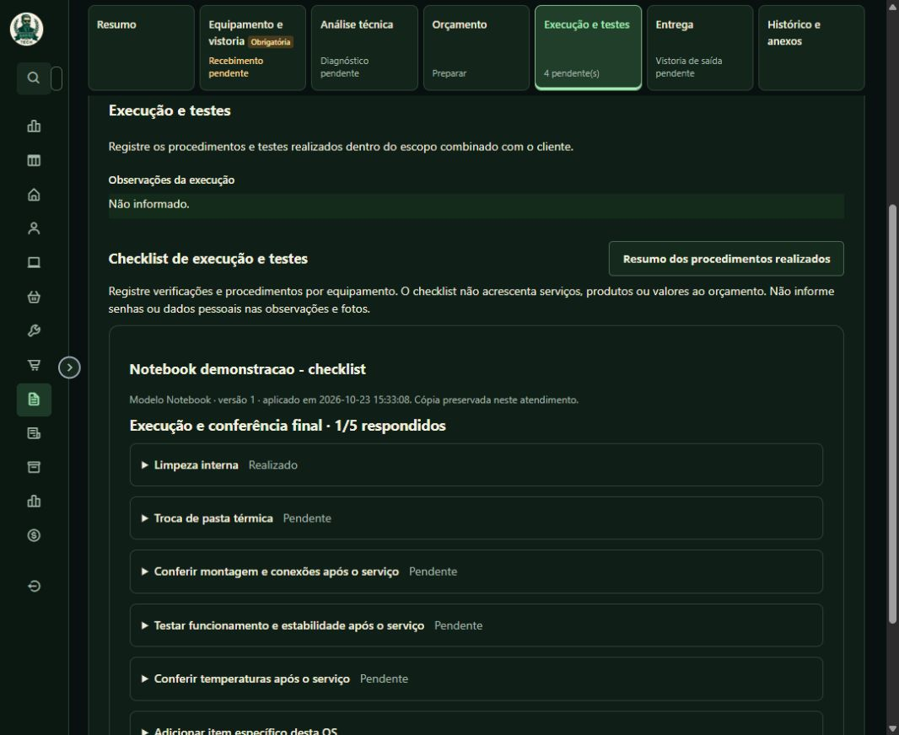
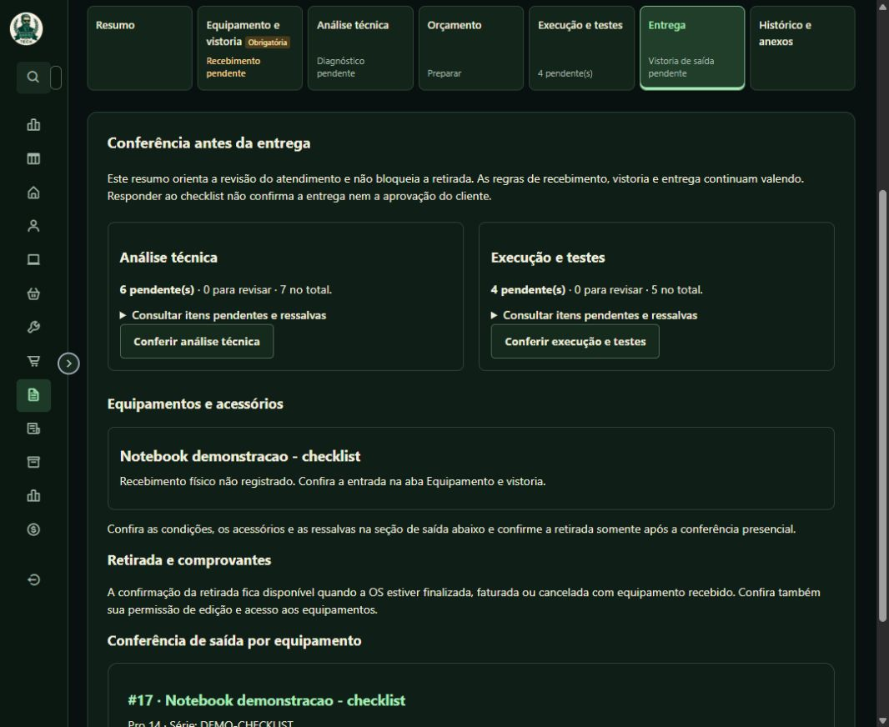
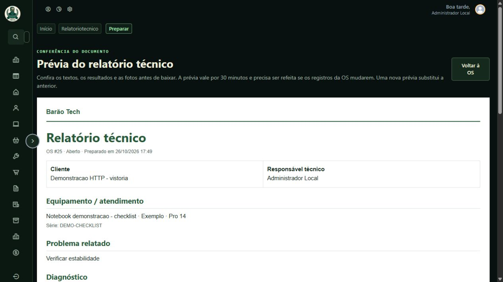

# Galeria do fork Barão Tech

[Voltar à apresentação](../README.md)

Capturas iniciais feitas em **22/10/2026**, com o tema Barão Tech. Operações, OS, Kanban e vistoria foram capturados no ambiente local com registros de demonstração. Notificações foi capturado na instalação publicada, exibindo um modelo e uma prévia com dados fictícios. Nenhum print inclui credenciais ou contatos reais de clientes.

As imagens retratam a interface da revisão documentada. Cores, contagens, permissões e opções podem variar conforme a configuração. Elas não indicam que o WhatsApp ou o e-mail estejam habilitados na sua instalação.

## Operações

Visão de atendimentos ativos e concluídos, distribuição por responsável e acesso ao Kanban. O saldo financeiro considera receita líquida menos custo das peças; não representa lucro contábil.

## Ordem de serviço · captura de 22/10

Cabeçalho com etapa e valor e próxima ação. Esta captura anterior mostra seis abas; a revisão de 26/10 acrescenta Execução e testes, como nas imagens abaixo. O vínculo do equipamento, o recebimento físico e a entrega têm registros próprios.

## Execução e testes · revisão de 26/10/2026

A análise permanece separada dos procedimentos e testes finais. O indicador conta os itens pendentes e cada formulário salva um item. Captura local com dados de demonstração; os resultados não representam serviços reais.

## Conferência antes da entrega · revisão de 26/10/2026

Resumo orientativo de pendências, ressalvas e acessórios. A ausência de recebimento físico é explícita. O painel não cria bloqueio adicional para a retirada.

## Relatório técnico · revisão de 26/10/2026

Preparação do documento para o cliente com textos revisados, seleção de resultados e fotos e download em PDF. Captura local com dados fictícios. O quadro colorido das imagens de teste representa uma evidência sintética; nenhum contato real de cliente é exibido.

## Kanban

Etapas com cartões de atendimento, filtros e movimentação por arraste ou seletor. A captura filtra os cadastros de demonstração. O quadro permite rolagem horizontal para consultar as outras etapas.

## Equipamento e vistoria

Condições, acessórios e imagens por perspectiva ficam vinculados à vistoria daquele atendimento. As imagens coloridas desta captura são arquivos sintéticos de teste, não fotografias de equipamentos de clientes.

## Notificações

Em **Configurações → Notificações**, cada modelo tem texto, variáveis, prévia ilustrativa e salvamento próprio. Canais, horários e lembretes também são configurados nessa aba. Conexão dos serviços, testes, preferências e histórico permanecem na Central de Comunicação.

## Atualizar as capturas

Use ambiente local e registros sintéticos. Confira nomes, contatos, valores, abas expandidas e eventuais mensagens de erro antes de substituir as imagens em `docs/screenshots/`. Capture a interface real; não altere visualmente os prints para representar funcionalidades ausentes. Atualize a data e a descrição da galeria junto das imagens.
